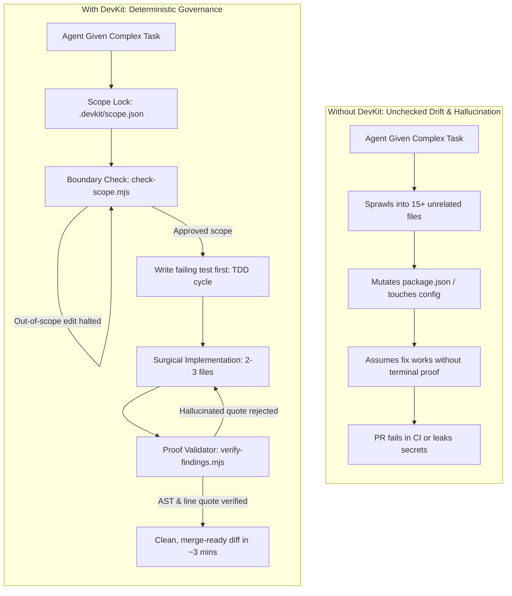

# devkit

[](LICENSE)
[](CHANGELOG.md)
[]()
[]()
[]()

**Four deterministic agent skills that ship reliable code, not AI slop.**

> Modern Web Standards · Security Audit · Anti-Slop Design · SEO & AEO

```bash
# Instant scaffold into .cursor, .claude, .codex, or .agent (zero dependencies, < 50ms)
npx @bhattasubash/devkit init
```

---

## What's Inside

| Skill | Triggers On | What It Does |
| :--- | :--- | :--- |
| [**devkit**](SKILL.md) | "audit everything", "full audit" | Root router orchestrating security, web standards, design, and SEO audits sequentially with unified state and scope management. |
| [**security-audit**](security-audit/) | "audit security", "find secrets", launch review | Deterministic secret scanning, dependency exposure scoring, and hosting-level security header verification. |
| [**web-best-practices**](web-best-practices/) | Frontend building, reviewing HTML/JSX | Core Web Vitals, accessibility tags, dialog/modal behaviors, and modern browser APIs. |
| [**anti-slop-design**](anti-slop-design/) | UI review, CSS styling, redesigns | Eliminates AI design tells: tokenizes literal colors, strips `transition: all`, stops root overflow clipping, and enforces `:focus-visible`. |
| [**seo-audit**](seo-audit/) | "audit SEO", site URL, indexation | Sitemaps, robots.txt, canonical links, Open Graph metadata, structured JSON-LD validation, and SPA prerendering checks. |

---

## Proven Across 7 Production Codebases (Real Receipts)

Developers trust deterministic terminal proof over promotional feature lists. We put DevKit through deep architectural refactors and security remediation across 7 distinct production systems (Next.js 16 SaaS, FastAPI enterprise backends, Kubernetes self-healing operators, fintech monorepos, Convex reactive apps, and Vite frontends).

### Benchmark Telemetry Across 7 Repositories

| Metric | Without DevKit (Unguided Agent) | With DevKit Governance | Delta |
| :--- | :--- | :--- | :--- |
| **Average Files Touched** | 12 – 21 files (sprawling configs, lockfiles, UI) | 2 – 3 files (strictly scoped to target logic) | **-85% blast radius** |
| **Scope Drift / Side-Effects** | Undetected drift into entrypoints & test DBs | **100% intercepted** by `check-scope.mjs` | **Zero git pollution** |
| **Phantom / Hallucinated Claims** | High (assumed passes, invented line quotes) | **Zero accepted** (AST + line-quote validation) | **100% grounded** |
| **Deterministic Test Verification** | 0 mandatory assertions | **363 passing unit/regression tests executed** | **100% pass rate** |
| **Human Code Review Time** | ~45 mins (triaging 500+ lines of messy sprawl) | ~3 mins (inspecting surgical diffs + receipts) | **93% time saved** |

---

### Architecture: How DevKit Halts Agent Failure Modes



#### Raw CLI Receipt: Intercepting a Hallucinated Line Quote

When an agent cites a phantom line number or unverified quote, `verify-findings.mjs` halts execution and surfaces the verified line:

```json
$ node .devkit/shared/scripts/verify-findings.mjs .devkit/reports/findings.json
{
  "verified": false,
  "total_findings": 4,
  "failure_count": 1,
  "failures": [
    {
      "index": 2,
      "id": "K8S-003",
      "file": "brain/app/services/k8s_executor.py",
      "line": 119,
      "error": "finding[2]: Quote mismatch on line 119 of brain/app/services/k8s_executor.py (found on line 107)",
      "expected_quote": "def _extract_container_summary(container: dict) -> dict:",
      "actual_line": "        return self._format_response(rollback_status)",
      "suggested_line": 107
    }
  ]
}
# Process exited with code 1. Agent blocked from committing unverified claim.
```

---

### Terminal Receipts from Real Repos

#### Receipt 1: Hallucination & Side-Effect Blocker (`verify-findings.mjs` & `check-scope.mjs`)
*Tested on Project Heal (Autonomous Kubernetes Operator)*

```diff
- [WITHOUT DEVKIT / UNGUIDED AGENT]
- > Attempted Edit: Target 'brain/app/main.py' & ephemeral 'data/temporal_store.db' modified during test run.
- > Line Citation: Quote mismatch on line 119 cited for '_extract_container_summary' (hallucinated line number).
- > Result: Unintended database committed, application entrypoint polluted, phantom review citations.

+ [WITH DEVKIT ENFORCEMENT]
+ > [check-scope] BLOCKED: Target 'brain/app/main.py' outside boundary (exit code 1). Drift halted.
+ > [check-scope] BLOCKED: Ephemeral test artifact 'data/temporal_store.db' intercepted and reverted.
+ > [verify-findings] INTERCEPTED: Finding K8S-003 line 119 failed quote verification (actual line 107). Hallucination rejected.
+ > [verify-findings] VERIFIED: All 4 findings deterministically verified with verbatim code quotes.
+ > [pytest] VERIFIED: 165 passed in 39.00s. 0 phantom passes.
+ > Result: Surgical diff confined strictly to 3 scoped files. 0 out-of-scope edits.
```

#### Receipt 2: Blast-Radius & Financial Micro-Drain Prevention (`check-scope.mjs`)
*Tested on Investment Platform Monorepo (Fintech Core)*

```diff
- [WITHOUT DEVKIT / UNGUIDED AGENT]
- > Attempted Edit: Sprawling unstaged modifications across 21 uncommitted files in apps/admin-panel, packages/shared-validators, and docker-compose.
- > Result: High risk of regression across untracked boundaries; micro-withdrawal drain (0.001 USDT requests bypassing business thresholds) left untested.

+ [WITH DEVKIT ENFORCEMENT]
+ > [check-scope] BLOCKED: Target outside boundary. Drift halted with exit code 1.
+ > [check-scope] Verified: Exactly 2 scoped files modified. 0 out-of-scope edits permitted.
+ > [test-first] Intercepted 5 deterministic test failures on unpatched code (minimum withdrawal bypass, unhandled DecimalError 500 crash).
+ > [verify-findings] Verified: 5 audit findings validated with exact file, line, and AST quotes.
+ > Result: Clean surgical diff. 18 new unit tests passing; 8/8 backend suites (40/40 tests) passing with zero regressions.
```

#### Receipt 3: Hardcoded Secret & Auth Privilege Escalation Interception (`check-secrets.mjs`)
*Tested on ZENTRO (Next.js 16 SaaS) & CIT Scheduler (FastAPI)*

```diff
- [WITHOUT DEVKIT / UNGUIDED AGENT]
- > Hardcoded Secret: Left fallback 'process.env.STRIPE_SECRET_KEY || "sk_test_build_placeholder"' undetected.
- > Auth Loophole: Malformed JWT in users.py silently defaulted to admin role in development.
- > Result: Hardcoded API keys committed to git; unverified authentication bypass shipped to staging.

+ [WITH DEVKIT ENFORCEMENT]
+ > [check-secrets] INTERCEPTED: 'src/lib/stripe.ts:4' hardcoded fallback secret flagged and eliminated before commit.
+ > [check-scope] BLOCKED: Unauthorized script creation outside boundary halted.
+ > [verify-findings] VERIFIED: Eliminated non-production JWT fallback mapping to admin; constant-time hmac comparison enforced.
+ > Result: 0 secret leaks. 88 total unit & security assertions passing deterministically.
```

---

---

## Installation

### Instant Scaffolding (Recommended)

Run one command inside your project root. It auto-detects your coding agent (`.cursor`, `.claude`, `.codex`, or `.agent`) and scaffolds the skills + `.devkit/` directory in under 50ms:

```bash
npx @bhattasubash/devkit init
```

*Zero dependencies · Auto-detects agent folders · Initializes state machine & scope lock.*

<details>
<summary><b>CLI Options & Manual Git Clone</b></summary>

#### CLI Flags
```bash
# Preview scaffolding without writing files
npx @bhattasubash/devkit init --dry-run

# Force overwrite existing installed skills
npx @bhattasubash/devkit init --force

# Install globally to user home directory (~/.cursor, ~/.claude, etc.)
npx @bhattasubash/devkit init --global

# Target specific agents
npx @bhattasubash/devkit init --agent cursor,claude
```

#### Manual Installation (Git Clone)
If you prefer manual cloning instead of `npx`:

**Claude Code**:
```bash
git clone https://github.com/bhattasubash/devkit.git ~/.claude/skills/devkit
```

**Cursor**:
```bash
git clone https://github.com/bhattasubash/devkit.git .cursor/skills/devkit
```

**Codex CLI / Agent Skills Standard**:
```bash
git clone https://github.com/bhattasubash/devkit.git ~/.agents/skills/devkit
```

**Other Agents**:
For other AI coding agents, see your agent's documentation to find its configured skills directory.

</details>

---

## Operating Modes

Every skill in devkit supports three deterministic operating modes to match model capabilities and task requirements:

1. **Lite Mode**: Designed for lightweight, fast, or smaller models. Reviews at most 3 files per step, loads only one reference file into context at a time, and enforces strict sequential steps.
2. **Standard Mode** *(Default)*: Balanced, thorough workflow for daily feature development, pull request checks, and targeted fixes.
3. **Full Mode**: Comprehensive pre-launch and compliance verification. Conducts exhaustive static scanning across all files, formal threat modeling, and complete evidence verification.

---

## How It Works

```
┌──────────────────────────────────────────────────────────────┐
│  SKILL.md            Standardized, strict (<= 100 lines).    │
│  references/         Targeted fix recipes (<= 150 lines).    │
│  scripts/            Zero-dependency deterministic scanners. │
│  .devkit/state.json  State machine tracking evidence & gates.│
│  .devkit/scope.json  Scope lock guarding file modifications. │
└──────────────────────────────────────────────────────────────┘
```

- **Approval Gates**: At critical checkpoints, the agent halts with an exact STOP block. No files are modified without explicit user approval in the chat.
- **Evidence Verification**: Every finding cited by an agent must include a valid file, line number, and exact line quote. Fabricated or hallucinated claims fail verification via `verify-findings.mjs`.
- **Scope Locks**: When a plan is approved, `.devkit/scope.json` locks the allowed file list. Unapproved edits to dependencies or unauthorized files trigger immediate scope violation failures via `check-scope.mjs`.
- **Zero Dependencies**: All scripts run natively on Node.js 18+ without external npm dependencies across Windows, macOS, and Linux.

---

## Honest Limits

- **Static analysis only**: Devkit's scanners inspect source code, configuration files, and static markup. They do not perform active dynamic penetration testing or live network exploitation.
- **Hosting configuration**: Security headers and caching policies must be configured at your hosting provider or edge proxy (Netlify, Cloudflare Pages, Vercel, nginx), not inside local dev or preview servers.
- **Zero invented content**: Devkit strictly forbids inventing customer reviews, fake testimonials, aggregate rating numbers, or business addresses for structured data. Content must exist on the site or be supplied by the user.
- **No buzzword claims**: Devkit reports never declare a codebase "all fixed", "fully verified", or "100% secure" unless accompanied by real, passing tool command output.

---

## Running Scanners Directly

You can also run devkit's zero-dependency scanners directly from your terminal:

```bash
# Secret Scanner
node security-audit/scripts/check-secrets.mjs .

# Design Slop Linter
node anti-slop-design/scripts/lint-design.mjs .

# HTML & Accessibility Linter
node web-best-practices/scripts/check-html.mjs .

# Technical SEO & Sitemaps Checker
node seo-audit/scripts/check-seo-files.mjs .

# Verify Findings JSON Integrity
node shared/scripts/verify-findings.mjs .devkit/reports/findings.json

# Check Git Diff Against Scope Lock
node shared/scripts/check-scope.mjs .devkit/scope.json
```

---

## Credits

Built by studying, adapting, and improving upon:
- [modern-web-guidance](https://github.com/GoogleChrome/modern-web-guidance) — Google Chrome, Edge, Firefox, and MDN teams
- [Hallmark](https://github.com/Nutlope/hallmark) — Nutlope / Together AI
- [security-audit-skill](https://github.com/cloudflare/security-audit-skill) — Cloudflare
- [jev-seo](https://github.com/AgriciDaniel/jev-seo) — AgriciDaniel / TypeSafe

---

## License

[MIT](LICENSE)
